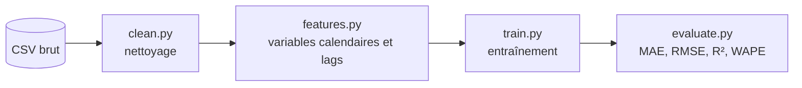
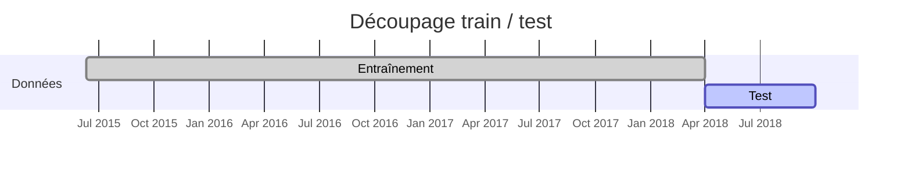

# 🚗 Prévision du trafic routier : projet MLOps


> **Peut-on anticiper les pics de congestion d'un axe routier à partir de l'historique du trafic et de la météo ?**

Projet réalisé dans le cadre du cours de **MLOps** (Master 2) par **Timandra DHENRY** et **Llaora DE OLIVEIRA**.

---

## 📌 Sommaire

1. [Contexte et problématique](#-contexte-et-problématique)
2. [Les données](#-les-données)
3. [Démarche](#-démarche)
4. [Résultats](#-résultats)
5. [Structure du dépôt](#-structure-du-dépôt)
6. [Installation et utilisation](#-installation-et-utilisation)
7. [Limites et perspectives](#-limites-et-perspectives)
8. [Équipe](#-équipe)

---

## 🎯 Contexte et problématique

Les gestionnaires d'un axe routier doivent anticiper les périodes de forte affluence pour réguler le trafic (information des usagers, ajustement des feux, déploiement d'équipes). Notre objectif est de **prévoir le volume de trafic horaire** sur l'autoroute I-94 afin d'aider à cette régulation.

Plus qu'un modèle sophistiqué, nous cherchons un **pipeline clair, reproductible et évalué avec des métriques parlantes** pour un lecteur non technique.

## 📊 Les données

- **Source :** [Metro Interstate Traffic Volume (Kaggle)](https://www.kaggle.com/datasets/pooriamst/metro-interstate-traffic-volume/data)
- **Contenu :** volume de trafic horaire sur l'I-94 (sens ouest, entre Minneapolis et St Paul), avec la météo (température, pluie, neige, nébulosité), les jours fériés et la description du temps.
- **Taille brute :** environ 48 000 lignes, d'octobre 2012 à septembre 2018.

Le fichier brut est dans `data/raw/`.

## 🧭 Démarche



1. **Analyse exploratoire** (`notebooks/01_exploration.ipynb`) : distribution du trafic, saisonnalité (heure, jour, mois), effet de la météo et des jours fériés.
2. **Nettoyage** (`src/clean.py`) :
   - suppression des doublons de timestamps (plusieurs lignes météo pour une même heure),
   - détection des valeurs aberrantes (température à 0 K, pluie supérieure à 100 mm),
   - conservation de la plus longue période continue (à partir de juin 2015, après un trou d'environ 10 mois),
   - grille horaire régulière et interpolation des petits trous (6 h maximum).
3. **Variables** (`src/features.py`) : heure, jour de la semaine, mois, week-end, jour férié, et **lags** (trafic de la veille et de la semaine précédente à la même heure).
4. **Modélisation** (`src/train.py`, `notebooks/02_modelisation.ipynb`) : baseline, régression linéaire et Random Forest.
5. **Évaluation** (`src/evaluate.py`) : métriques adaptées aux séries temporelles et validation croisée temporelle.

### ⏱️ Un découpage chronologique, jamais aléatoire

Pour une série temporelle, mélanger les données ferait « voir le futur » au modèle et gonflerait les scores. On entraîne donc sur le passé et on teste sur la période la plus récente.



La **validation croisée temporelle** (`TimeSeriesSplit`) répète cette logique sur plusieurs périodes successives de trois mois pour vérifier la stabilité des résultats.

## 📈 Résultats

Résultats sur le jeu de test (avril à septembre 2018) :

| Modèle | MAE | RMSE | R² | WAPE |
|---|---|---|---|---|
| Baseline (trafic de la veille) | 539,6 | 1 018,9 | 0,735 | 16,1 % |
| Régression linéaire | 311,5 | 554,4 | 0,922 | 9,3 % |
| **Random Forest** | **239,7** | **439,2** | **0,951** | **7,2 %** |

- **MAE / RMSE** : erreur en nombre de véhicules par heure (la RMSE pénalise davantage les pics mal anticipés).
- **WAPE** : erreur totale en % du volume de trafic. Nous l'utilisons à la place du MAPE car le trafic peut être nul à certaines heures, ce qui rend le MAPE inutilisable.
- **Validation croisée temporelle (Random Forest) :** WAPE moyen d'environ 8 %, entre 6,6 % et 9,9 % selon la période.

**Lecture métier :** le modèle divise par deux l'erreur de la baseline. Il reproduit bien le rythme quotidien (creux de nuit, pics du matin et du soir). La variable la plus déterminante est le trafic de la **semaine précédente à la même heure**, tandis que la météo pèse peu. Les journées atypiques restent plus difficiles à anticiper.

<!-- Pour afficher un graphique ici : l'enregistrer depuis le notebook avec plt.savefig("../documentation/prediction_vs_realite.png", dpi=150, bbox_inches="tight"), puis décommenter la ligne suivante.

-->

## 🗂️ Structure du dépôt

```text
Traffic_Forecasting_MLOps/
├── data/
│   ├── raw/                    # données brutes (Metro_Interstate_Traffic_Volume.csv)
│   └── processed/              # données transformées (générées)
├── notebooks/
│   ├── 01_exploration.ipynb    # analyse exploratoire
│   └── 02_modelisation.ipynb   # modélisation et évaluation
├── src/
│   ├── clean.py                # nettoyage des données
│   ├── features.py             # variables calendaires et lags
│   ├── train.py                # découpage, modèles, entraînement
│   └── evaluate.py             # métriques et validation croisée temporelle
├── tests/                      # tests unitaires
├── documentation/              # notes et figures
├── requirements.txt
└── README.md
```

## ⚙️ Installation et utilisation

```bash
# 1. Récupérer le projet
git clone https://github.com/TimandraD/Traffic_Forecasting_MLOps.git
cd Traffic_Forecasting_MLOps

# 2. Créer un environnement et installer les dépendances
python -m venv .venv
source .venv/bin/activate          # Windows : .venv\Scripts\activate
pip install -r requirements.txt

# 3. Lancer les notebooks
jupyter notebook
```

Ouvrez ensuite `notebooks/01_exploration.ipynb`, puis `notebooks/02_modelisation.ipynb`, et exécutez les cellules dans l'ordre.

Les fonctions peuvent aussi être utilisées directement :

```python
from src.clean import load_and_clean_data
from src.features import add_time_features, add_lag_features
from src.train import prepare_dataset, split_train_test, train_model, FEATURES, TARGET
from src.evaluate import evaluate

df = load_and_clean_data("data/raw/Metro_Interstate_Traffic_Volume.csv")
df = prepare_dataset(add_lag_features(add_time_features(df)))
train, test = split_train_test(df)

modele = train_model(train, "random_forest")
print(evaluate(test[TARGET], modele.predict(test[FEATURES])))
```

## 🔭 Limites et perspectives

- **Les lags supposent un historique connu** : le modèle prévoit à partir du trafic d'il y a 24 h et 7 jours. Les variables météo devraient provenir de prévisions dans un usage réel.
- **Données anciennes (2012-2014) écartées** à cause d'un trou de plusieurs mois dans la série.
- **Pistes d'amélioration :** modèles de gradient boosting (LightGBM, XGBoost), réglage des hyperparamètres, suivi des expériences avec **MLflow**, tests unitaires sur le nettoyage et les variables.

## 👥 Équipe

- **Timandra DHENRY**
- **Llaora DE OLIVEIRA**
